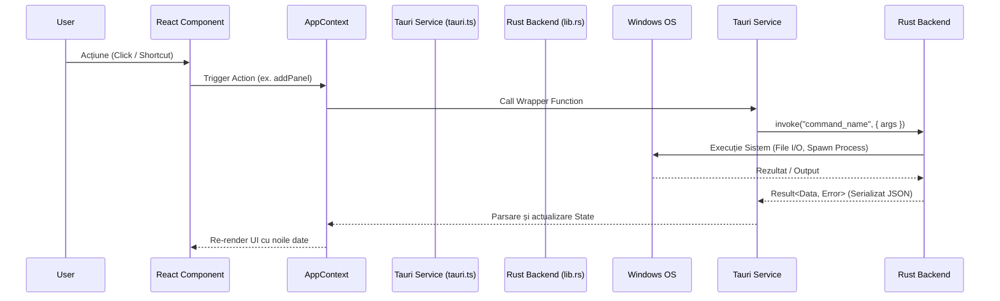

# Canopy — Arhitectură și Documentație Tehnică

Acest document oferă o privire de ansamblu exhaustivă asupra aplicației **Canopy**, detaliind tehnologiile folosite, arhitectura sistemului, API-urile de backend, dependențele și modul în care componentele interacționează atât între ele, cât și cu sistemul de operare Windows.

---

## 1. Tehnologii și Dependențe (Tech Stack)

Aplicația este construită folosind o arhitectură hibridă oferită de **Tauri**, care îmbină un frontend web modern cu un backend nativ rapid.

### 1.1. Frontend (React + TypeScript)
- **Framework**: React 18, setat folosind Vite pentru un build extrem de rapid.
- **Stilizare**: Vanilla CSS (`index.css`) folosind variabile CSS native pentru a crea un design system propriu. Implementează efecte moderne precum *glassmorphism* (blur) și micro-animații. Fără framework-uri greoaie de CSS.
- **Iconițe**: `react-icons` (mai specific pachetul `tb` - Tabler Icons) pentru o estetică minimalistă și unitară.
- **Stare (State Management)**: React Context API (`AppContext.tsx`). Gestionarea stării la nivel global elimină prop-drilling-ul și oferă o "Sursă Unică de Adevăr" pentru întreaga interfață.

### 1.2. Backend (Rust)
- **Framework Core**: Tauri (`tauri` v2.x). Oferă bridge-ul IPC (Inter-Process Communication) și ferestrele native ale sistemului de operare (fără să includă un browser heavy precum Electron; folosește WebView2 pe Windows).
- **Parsare JSON**: `serde` și `serde_json` pentru serializarea datelor transmise între Rust și React.
- **Interacțiune Sistem**:
  - `std::process::Command` (Standard Rust Library) pentru invocarea directă a proceselor (Terminal, VSCode, Explorer).
  - `arboard` (v3): Librărie cross-platform, folosită aici specific pentru a interacționa curat cu clipboard-ul de Windows (copierea căilor fișierelor).
- **Tauri Plugins**:
  - `tauri-plugin-dialog`: Oferă acces la selectorul nativ de foldere/fișiere din Windows.
  - `tauri-plugin-log`: Folosit intern (dacă e necesar) pentru debugging-ul aplicației.

---

## 2. Arhitectura de Sistem și Comunicarea (IPC)

Modelul de comunicare se bazează pe trecerea asincronă a mesajelor între firul de execuție al interfeței (JavaScript) și firul de execuție al nucleului (Rust) prin intermediul **IPC (Inter-Process Communication)**.



### 2.1. Layer-ul de Abstracție (Tauri Service)
Fișierul `frontend/src/services/tauri.ts` este crucial. El este singurul loc din frontend unde se apelează funcția `invoke()` oferită de Tauri. Această decuplare permite:
- **Graceful Degradation**: Dacă aplicația este pornită într-un browser standard (ex. cu `npm run dev`), serviciul interceptează lipsa mediului Tauri și folosește funcții de mock sau `console.log`.
- **Tipizare Strictă**: Toate promisiunile întoarse din Rust primesc tipuri TypeScript valide înainte să ajungă în `AppContext`.

---

## 3. Structura și Ierarhia de Componente Frontend

Aplicația vizuală se împarte în **Componente Structurale** și **Overlay-uri**.

- **`App.tsx`**: Rădăcina aplicației. Montează fundalul decorativ (`scene`, `sunset-orb`) și înfășoară logica aplicației. Aici este setat și listener-ul global pentru comanda `Ctrl+Shift+P`.
- **`TitleBar.tsx`**: Bara de titlu personalizată. Interceptează click-urile de tragere și trimite comenzi către OS pentru mișcarea ferestrei, minimizare sau închidere.
- **`Panels.tsx` & `PanelHeader.tsx`**: Gestionează grid-ul în care sunt dispuse proiectele. 
- **`TreeView.tsx`**: Componentă cheie, **recursivă**. Parcurge structura `TreeNode` primită de la backend și se auto-apelează pentru a desena folderele în adâncime. Conține logica de calculare a *path-urilor* pentru a ști cu exactitate ce fișier a fost apăsat.
- **Overlay-uri (`CommandPalette.tsx` & `ContextMenu.tsx`)**: Plutesc deasupra aplicației (`position: fixed`). Folosesc `z-index` mare și dispun de navigare din tastatură (săgeți, enter, esc).

---

## 4. API-uri Backend și Interacțiunea cu Sistemul (Rust)

Acestea sunt funcțiile definite în `lib.rs`, care acționează ca un API intern pentru aplicație. Ele folosesc paradigma de `Result<T, E>` din Rust pentru a garanta siguranța execuției.

### 4.1. Scanarea Sistemului de Fișiere
```rust
#[tauri::command]
fn read_directory(path: String) -> Result<Vec<FileNode>, String>
```
- **Rol**: Primește un absolute-path. Folosește `std::fs::read_dir` pentru a traversa folderele.
- **Optimizări**: Ignoră recursivitatea pentru foldere grele/inutile (`node_modules`, `.git`, `target`, `__pycache__` etc.), prevenind astfel lag-ul și consumul nejustificat de memorie.
- **Auto-Detect**: Asociază o "etichetă" (ex. `py`, `cpp`) fișierelor pe baza extensiei. Sortează rezultatul: folderele mai întâi, alfabetic, apoi fișierele.

### 4.2. Invocarea Proceselor (Spawning)
Comenzile de interacțiune cu Windows-ul folosesc `std::process::Command::new(...)`. Folosirea metodei `.spawn()` în loc de `.output()` garantează că aplicația Canopy nu va rămâne blocată așteptând închiderea procesului lansat.

- **`open_in_vscode(path: String)`**: Apelează `code <path>`. Necesită ca VSCode să fie adăugat în variabilele de mediu (PATH).
- **`open_terminal(path: String)`**: 
  - Încearcă primar să deschidă noul Windows Terminal (`wt -d <path>`).
  - Oferă fallback: dacă utilizatorul nu are `wt`, deschide Command Prompt clasic (`cmd /K cd /d <path>`).
- **`open_in_explorer(path: String)`**: Deschide native file explorer la locația respectivă: `explorer <path>`.

### 4.3. Gestionarea Clipboard-ului
```rust
#[tauri::command]
fn copy_to_clipboard(text: String) -> Result<(), String>
```
- Ocolește izolarea de browser și scrie direct în clipboard-ul sistemului Windows utilizând `arboard::Clipboard::new()`. 

---

## 5. Permisiuni de Sistem și Siguranță (Tauri Capabilities)

Pentru ca funcțiile de mai sus să meargă, Canopy este instruit să iasă din sandbox-ul strict al unui webview normal, prin fișierul `capabilities/default.json`:

1. **`core:window:*`**: Oferă interfeței React dreptul să "atingă" starea ferestrei (tragere, închidere, minimizare).
2. **`dialog:default`**: Fără această permisiune, butonul de adăugare folder (`+ add`) ar fi blocat de sistem. Permisiunea deschide puntea către ferestrele native `OpenFileDialog` din Windows.

---

## 6. Fluxul Datelor: Adăugarea unui Proiect Nou

Pentru a înțelege exact legătura cap-la-cap, iată ce se întâmplă tehnic când adaugi un folder nou în aplicație:

1. Click pe butonul `+ add` din React.
2. `AppContext.tsx` apelează `pickFolder()` din `tauri.ts`.
3. Tauri lansează dialogul nativ Windows. Utilizatorul alege un folder (ex. `C:\MyProject`).
4. Rust trimite string-ul înapoi către React.
5. React ia calea și apelează imediat `readDirectory("C:\MyProject")`.
6. Rust scanează folderul `MyProject`, ignoră `.git`/`node_modules`, convertește structura într-un JSON (Tree) și o întoarce.
7. React preia JSON-ul, generează un ID unic de panou și salvează tree-ul în `AppContext`.
8. React declanșează un render, iar `Panels.tsx` împreună cu `TreeView.tsx` afișează noul folder cu toate culorile și pictogramele aferente.
