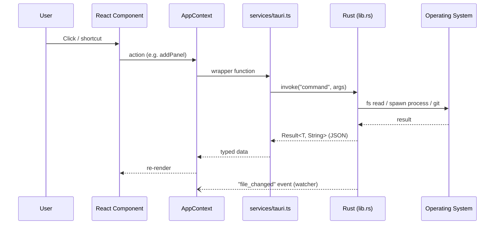

<p align="center">
  
</p>

<h1 align="center">Canopy</h1>

<p align="center">
  <a href="https://github.com/CristianPreda1609/canopy/actions/workflows/ci.yml"></a>
</p>

**Canopy** is a lightweight desktop app for **Windows, macOS and Linux** that puts all of your projects side by side as live file trees. Each project is a panel, and you can jump from any file or folder into VS Code, a terminal or your file manager with one click.

Canopy is built with **[Tauri 2](https://tauri.app/)**, so it uses a native Rust backend and the system WebView2. It doesn't bundle a whole browser.

---

## Table of Contents

- [Features](#features)
- [Tech Stack](#tech-stack)
- [Project Structure](#project-structure)
- [Getting Started](#getting-started)
  - [Prerequisites](#prerequisites)
  - [Installation](#installation)
  - [Running in Development](#running-in-development)
  - [Building a Release](#building-a-release)
- [Usage](#usage)
  - [Keyboard Shortcuts](#keyboard-shortcuts)
  - [Command Palette](#command-palette)
  - [Context Menu](#context-menu)
  - [Git Status Colors](#git-status-colors)
- [How It Works](#how-it-works)
  - [Architecture](#architecture)
  - [Backend Commands (Rust API)](#backend-commands-rust-api)
  - [Directory Scanning Rules](#directory-scanning-rules)
  - [Permissions (Tauri Capabilities)](#permissions-tauri-capabilities)
- [Development Notes](#development-notes)
- [Roadmap / Known Limitations](#roadmap--known-limitations)
- [License](#license)

---

## Features

- 📂 **Multi-panel workspace**: open any number of project folders, each in its own panel.
- 🌲 **Fast recursive file tree**: folders come first and everything is sorted alphabetically. Heavy directories such as `node_modules`, `target` and `.git` are skipped automatically.
- 🗜️ **Compact folders**: chains of single-child folders are merged into one row (`src / main / java`), the same way VS Code does it.
- 🔄 **Live reload**: a file watcher on each panel refreshes the tree when files are created, modified or deleted.
- 🌿 **Git integration**: shows the current branch and whether there are uncommitted changes, and colors each file by its git status.
- ⚡ **Quick actions**: open a file or folder in **VS Code**, a **terminal**, or the system **file manager** (Explorer / Finder / your Linux default), reveal it there, or copy its path.
- 🖥️ **Cross-platform**: Windows, macOS and Linux, each using its native terminal and file manager.
- 🧱 **Two layouts**: a wrapping grid, or a single scrollable row of panels (remembered between launches).
- 🎛️ **Command palette** (`Ctrl+Shift+P`) with fuzzy filtering and keyboard navigation.
- 💾 **Persistent workspace**: the panels you open are remembered between launches.
- 🪟 **Frameless, transparent window** with a custom title bar and a glassmorphism UI.
- 🧪 **Browser fallback**: the frontend also runs in a regular browser (`npm run dev`), with mocked native calls for UI work.

---

## Tech Stack

| Layer      | Technology                                                                 |
|------------|-----------------------------------------------------------------------------|
| Shell      | [Tauri 2](https://tauri.app/) (WebView2 / WKWebView / WebKitGTK)             |
| Backend    | Rust (edition 2021): `serde`, `notify` (file watching), `arboard` (clipboard) |
| Plugins    | `tauri-plugin-dialog` (native folder picker), `tauri-plugin-log`             |
| Frontend   | React 19 + TypeScript, bundled with Vite                                     |
| State      | React Context API (`AppContext`)                                             |
| Styling    | Vanilla CSS with custom properties (no CSS framework)                        |
| Icons      | [`react-icons`](https://react-icons.github.io/react-icons/) (Tabler set)     |
| Quality    | ESLint, `node:test` (frontend), `cargo test` + Clippy (backend)              |
| CI / CD    | GitHub Actions: checks on all 3 OSes, tagged releases build installers       |

---

## Project Structure

```
canopy/
├── frontend/                    # React + TypeScript UI (Vite)
│   ├── index.html
│   ├── package.json
│   ├── vite.config.ts
│   └── src/
│       ├── main.tsx             # React entry point
│       ├── App.tsx              # Root component, global Ctrl+Shift+P listener
│       ├── index.css            # Design system (CSS variables, glass effects)
│       ├── contexts/
│       │   └── AppContext.tsx   # Global state: panels, trees, git info, persistence
│       ├── services/
│       │   ├── tauri.ts         # The ONLY place that calls Tauri invoke()
│       │   ├── paths.ts         # Cross-platform path helpers (+ paths.test.ts)
│       └── components/
│           ├── TitleBar.tsx     # Custom frameless title bar (drag/min/max/close)
│           ├── Panels.tsx       # Panel grid
│           ├── PanelHeader.tsx  # Panel title, badge, git branch, close button
│           ├── TreeView.tsx     # Recursive file tree with git coloring
│           ├── ContextMenu.tsx  # Right-click / Ctrl+hover actions
│           ├── CommandPalette.tsx
│           └── StatusBar.tsx
│
├── src-tauri/                   # Rust backend
│   ├── Cargo.toml
│   ├── app-icon.png             # 1024px source icon (regenerate with `cargo tauri icon app-icon.png`)
│   ├── tauri.conf.json          # Window, build & security (CSP) config
│   ├── capabilities/
│   │   └── default.json         # Permissions granted to the webview
│   ├── icons/
│   └── src/
│       ├── main.rs              # Binary entry point
│       └── lib.rs               # Tauri commands (fs, git, watcher, shell, clipboard)
│
├── .github/workflows/
│   ├── ci.yml                   # Lint, test, build, clippy on Windows/macOS/Linux
│   └── release.yml              # Tag v* → installers for all platforms
├── ARCHITECTURE.md              # In-depth technical documentation (Romanian)
├── LICENSE                      # Apache 2.0
└── README.md
```

---

## Getting Started

### Prerequisites

**All platforms:**

| Requirement | Notes |
|-------------|-------|
| [Node.js](https://nodejs.org/) **22.18+** (24 recommended) and npm | For the frontend toolchain. `npm test` relies on native TypeScript support |
| [Rust](https://rustup.rs/) **1.77.2+** (stable) | |
| [Tauri CLI](https://tauri.app/reference/cli/) | `cargo install tauri-cli --version "^2"` |
| *Optional:* [VS Code](https://code.visualstudio.com/) with `code` on your `PATH` | Needed for "Open in VS Code" |
| *Optional:* [Git](https://git-scm.com/) on your `PATH` | Needed for git status info |

**Per platform:**

| OS | Extra requirements |
|----|--------------------|
| **Windows 10/11** | [Microsoft C++ Build Tools](https://visualstudio.microsoft.com/visual-cpp-build-tools/) (*Desktop development with C++*), [WebView2](https://developer.microsoft.com/microsoft-edge/webview2/) (preinstalled on Windows 11). Optional: [Windows Terminal](https://aka.ms/terminal), with a fallback to `cmd` |
| **macOS** | Xcode Command Line Tools: `xcode-select --install` |
| **Linux** (Debian/Ubuntu) | `sudo apt install libwebkit2gtk-4.1-dev build-essential curl wget file libxdo-dev libssl-dev libayatana-appindicator3-dev librsvg2-dev` |

**How the integrations behave on each OS:**

| Action | Windows | macOS | Linux |
|--------|---------|-------|-------|
| Terminal | `wt`, falling back to `cmd` | Terminal.app | First found: `x-terminal-emulator`, `gnome-terminal`, `konsole`, `xfce4-terminal`, `kitty`, `alacritty`, `wezterm`, `xterm` |
| File manager | Explorer | Finder | `xdg-open` / `gio open` |
| Reveal | `explorer /select,` | `open -R` | Opens the containing folder |
| VS Code | `code` | `code`, falling back to `open -a "Visual Studio Code"` | `code`, falling back to `codium` |

See the official [Tauri prerequisites guide](https://tauri.app/start/prerequisites/) for more detail.

### Installation

```powershell
git clone https://github.com/CristianPreda1609/canopy.git
cd canopy

# Install frontend dependencies
cd frontend
npm install
cd ..
```

Cargo downloads the Rust dependencies automatically on the first build.

### Running in Development

From the **`src-tauri`** directory, where `tauri.conf.json` lives:

```powershell
cd src-tauri
cargo tauri dev
```

This starts the Vite dev server on `http://localhost:5173` (via `beforeDevCommand`), compiles the Rust backend and opens the Canopy window with hot reload.

**Frontend-only mode.** To work on the UI without the Rust side:

```powershell
cd frontend
npm run dev
```

Native calls are mocked in this mode. They log to the console or return empty data.

### Building a Release

```powershell
cd src-tauri
cargo tauri build
```

The build runs `npm run build` for the frontend and then compiles an optimized binary. The installers end up in `src-tauri/target/release/bundle/`: MSI/NSIS on Windows, `.dmg`/`.app` on macOS, and `.deb`/`.rpm`/`.AppImage` on Linux.

### Testing

```powershell
cd frontend;  npm test          # path helper unit tests (node:test)
cd src-tauri; cargo test --lib  # git parsing, watcher filter, tree building
cd src-tauri; cargo clippy --all-targets -- -D warnings
```

### Continuous Integration & Releases

- **CI** (`.github/workflows/ci.yml`) runs on every push to `main` and on every PR:
  - **Frontend:** lint, unit tests and production build.
  - **Backend:** Clippy (warnings count as errors) and `cargo test`, on **Windows, macOS and Linux**.
- **Release** (`.github/workflows/release.yml`): push a version tag to build installers for every platform. Windows, Linux, and macOS on both Apple Silicon and Intel are built and attached to a **draft** GitHub Release:
  ```powershell
  git tag v0.1.0
  git push origin v0.1.0
  ```
  Review the draft on GitHub and publish it. The macOS builds aren't signed or notarized, so on first launch users have to right-click → **Open**.

### Other scripts (in `frontend/`)

| Command           | Description                         |
|-------------------|-------------------------------------|
| `npm run dev`     | Start the Vite dev server           |
| `npm run build`   | Type-check (`tsc -b`) and build     |
| `npm run lint`    | Run ESLint                          |
| `npm test`        | Run unit tests                      |
| `npm run preview` | Preview the production build        |

### Changing the app icon

Replace `src-tauri/app-icon.png` (1024×1024, transparent PNG), then run this from `src-tauri`:

```powershell
cargo tauri icon app-icon.png
```

Copy `icons/64x64.png` to `frontend/public/favicon.png` and `icons/128x128.png` to `frontend/src/assets/canopy-logo.png` to update the favicon and the title bar logo.

---

## Usage

1. Click **`+ add`**, or run **Open folder in panel** from the command palette, and pick a project folder.
2. The folder appears as a new panel showing its file tree, git branch and dirty state.
3. Click folders to expand or collapse them.
4. Right-click any file or folder, or hold **Ctrl** while hovering over it, to open the context menu.
5. Close a panel with the **×** in its header. Your open panels are restored the next time you start Canopy.

### Keyboard Shortcuts

| Shortcut              | Action                                  |
|-----------------------|-----------------------------------------|
| `Ctrl + Shift + P`    | Open / close the command palette        |
| `↑` / `↓`             | Move the selection in the palette       |
| `Enter`               | Run the selected command                |
| `Esc`                 | Close the palette or context menu       |
| `Ctrl` + hover        | Open the context menu on a tree item    |

### Command Palette

| Command                | Description                                      |
|------------------------|--------------------------------------------------|
| Open folder in panel   | Pick a folder and add it as a new panel          |
| Open in VSCode         | Open the current panel's folder in VS Code       |
| Open terminal here     | Open a terminal at the location                  |
| Open in Explorer / Finder / file manager | Open the containing folder  |
| Reveal in Explorer / Finder / file manager | Show the item selected in its folder |
| Toggle layout          | Switch between grid and row layout (also the title bar button) |
| Settings               | *(placeholder, not implemented yet)*             |

### Context Menu

Right-click (or `Ctrl`+hover) on a tree node to:

- Open it in **VS Code**
- Open a **terminal** in that location
- Open it, or **reveal it**, in the file manager
- **Copy its full path** to the clipboard

### Git Status Colors

If a panel's root folder is a git repository, each file in its tree is colored by its status:

| Color        | Status      |
|--------------|-------------|
| 🟠 Orange    | Modified    |
| 🟢 Green     | Staged      |
| 🟣 Faded purple | Untracked |
| 🔴 Red       | Conflict / Deleted |

---

## How It Works

### Architecture

React components never talk to Rust directly. Every call goes through `services/tauri.ts`, and the backend responds through Tauri's IPC bridge:



**What happens when you add a project:**

1. `pickFolder()` opens the native folder dialog through `tauri-plugin-dialog`.
2. `read_directory` scans the folder (up to 8 levels deep) and returns a compacted JSON tree.
3. `get_git_info` runs `git status --porcelain=v1 -b`, which gives both the branch and the status of each file. It also works in worktrees and submodules. If git isn't installed, the panel simply shows no git info.
4. `watch_directory` starts a recursive `notify` watcher. It ignores changes inside skipped folders (`node_modules`, `target`, `.git/objects`, …), but reacts to `.git/index` and `.git/HEAD` so the git colors update when you stage or switch branches. It emits `file_changed` at most every 200ms, and the frontend debounces that and re-reads the panel.
5. The panel's path is saved to `localStorage` under the key `canopy_panels`.

### Backend Commands (Rust API)

All commands live in `src-tauri/src/lib.rs` and return `Result<T, String>`.

| Command | Arguments | Returns | Description |
|---------|-----------|---------|-------------|
| `read_directory` | `path` | `FileNode[]` | Recursive scan (max depth 8), sorted and compacted |
| `get_git_info` | `path` | `GitStatus \| null` | Branch, dirty flag and per-file status. Returns `null` if the folder isn't a repository |
| `watch_directory` | `panelId`, `path` | `()` | Starts a recursive watcher that emits `file_changed` |
| `unwatch_directory` | `panelId` | `()` | Stops the panel's watcher |
| `open_in_vscode` | `path` | `()` | Opens VS Code (see the per-OS table above) |
| `open_terminal` | `path` | `()` | Opens a terminal in that folder |
| `open_in_explorer` | `path` | `()` | Opens the folder in the system file manager |
| `reveal_in_explorer` | `path` | `()` | Shows the item selected in the file manager |
| `copy_to_clipboard` | `text` | `()` | Writes the text to the system clipboard via `arboard` |

**Data shapes:**

```ts
type TreeNode = {
  name: string;
  type: 'file' | 'folder';
  children?: TreeNode[];
  iconType?: 'py' | 'cpp' | 'js' | 'ts' | 'rs' | 'json' | 'config' | 'doc' | 'web';
  compactPath?: string;   // e.g. "src / main / " when folders were compacted
};

type GitStatus = {
  branch: string;         // or "detached"
  is_dirty: boolean;
  files: { path: string; status: 'modified' | 'staged' | 'untracked' | 'deleted' | 'conflict' | 'unknown' }[];
};
```

### Directory Scanning Rules

- **Hidden entries**: anything whose name starts with `.` is skipped.
- **Heavy directories**: these folders are listed but never scanned, so they always appear empty:
  `node_modules`, `target`, `.git`, `__pycache__`, `.venv`, `venv`, `.idea`, `.vscode`, `dist`, `build`, `.next`, `.cache`, `vendor`, `packages`, `.svn`, `obj`, `bin`
- **Unreadable folders** (for example, permission denied) appear empty instead of breaking the tree.
- **Max depth**: 8 levels.
- **Sorting**: folders first, then files, alphabetically and case-insensitive.
- **Icons**: the file extension determines `iconType` (for example `.py` → `py` and `.yml` → `config`).

### Permissions (Tauri Capabilities)

`src-tauri/capabilities/default.json` grants the webview only what it needs:

- `core:default`
- `core:window:allow-start-dragging`, `allow-minimize`, `allow-maximize`, `allow-close`, used by the custom title bar
- `dialog:default`, used by the native folder picker

A strict **Content Security Policy** is also set in `tauri.conf.json`. It allows only the app itself, the Tauri IPC channel and Google Fonts. `macOSPrivateApi` is enabled so the transparent, frameless window renders correctly on macOS; the trade-off is that the app can't be submitted to the Mac App Store.

---

## Development Notes

- **The only place to add backend calls is `services/tauri.ts`.** Each wrapper checks `isTauri` so the UI keeps working in a plain browser.
- **To add a new Rust command:** write a `#[tauri::command]` function in `lib.rs`, register it in `generate_handler![...]`, and add a typed wrapper in `tauri.ts`.
- **New window or plugin APIs** need a matching permission in `capabilities/default.json`.
- More detailed (Romanian) technical documentation is in [`ARCHITECTURE.md`](./ARCHITECTURE.md).

---

## Roadmap / Known Limitations

- [x] Cross-platform support (Windows, macOS, Linux)
- [x] Layout toggle
- [x] CI on all three OSes, plus automated release builds
- [ ] **Settings** panel (the button is still a placeholder). Planned: skipped directories, max depth, theme.
- [ ] Load very large folders lazily instead of scanning them all at once.
- [ ] Sign and notarize the macOS builds.

---

## License

Distributed under the **Apache License 2.0**. See [`LICENSE`](./LICENSE) for details.
