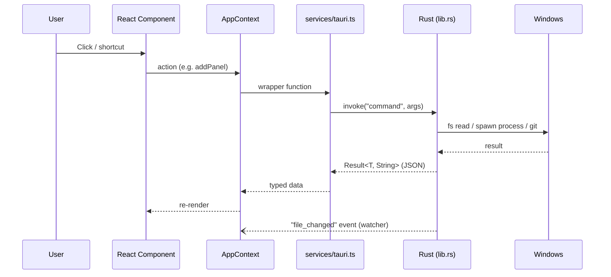

# 🌳 Canopy

**Canopy** is a lightweight Windows desktop app that puts all of your projects side by side as live file trees. Each project is a panel, and you can jump from any file or folder into VS Code, a terminal or Explorer with one click.

Canopy is built with **[Tauri 2](https://tauri.app/)**, so it uses a native Rust backend and the system WebView2. It doesn't bundle a whole browser.

---

## Table of Contents

- [Features](#features)
- [Tech Stack](#tech-stack)
- [Project Structure](#project-structure)
- [Getting Started](#getting-started)
  - [Prerequisites](#prerequisites)
  - [Installation](#installation)
  - [Running in Development](#running-in-development)
  - [Building a Release](#building-a-release)
- [Usage](#usage)
  - [Keyboard Shortcuts](#keyboard-shortcuts)
  - [Command Palette](#command-palette)
  - [Context Menu](#context-menu)
  - [Git Status Colors](#git-status-colors)
- [How It Works](#how-it-works)
  - [Architecture](#architecture)
  - [Backend Commands (Rust API)](#backend-commands-rust-api)
  - [Directory Scanning Rules](#directory-scanning-rules)
  - [Permissions (Tauri Capabilities)](#permissions-tauri-capabilities)
- [Development Notes](#development-notes)
- [Roadmap / Known Limitations](#roadmap--known-limitations)
- [License](#license)

---

## Features

- 📂 **Multi-panel workspace**: open any number of project folders, each in its own panel.
- 🌲 **Fast recursive file tree**: folders come first and everything is sorted alphabetically. Heavy directories such as `node_modules`, `target` and `.git` are skipped automatically.
- 🗜️ **Compact folders**: chains of single-child folders are merged into one row (`src / main / java`), the same way VS Code does it.
- 🔄 **Live reload**: a file watcher on each panel refreshes the tree when files are created, modified or deleted.
- 🌿 **Git integration**: shows the current branch and whether there are uncommitted changes, and colors each file by its git status.
- ⚡ **Quick actions**: open a file or folder in **VS Code**, **Windows Terminal** (falls back to `cmd`) or **Explorer**, reveal it in Explorer, or copy its path.
- 🎛️ **Command palette** (`Ctrl+Shift+P`) with fuzzy filtering and keyboard navigation.
- 💾 **Persistent workspace**: the panels you open are remembered between launches.
- 🪟 **Frameless, transparent window** with a custom title bar and a glassmorphism UI.
- 🧪 **Browser fallback**: the frontend also runs in a regular browser (`npm run dev`), with mocked native calls for UI work.

---

## Tech Stack

| Layer      | Technology                                                                 |
|------------|-----------------------------------------------------------------------------|
| Shell      | [Tauri 2](https://tauri.app/) (WebView2 on Windows)                          |
| Backend    | Rust (edition 2021): `serde`, `notify` (file watching), `arboard` (clipboard) |
| Plugins    | `tauri-plugin-dialog` (native folder picker), `tauri-plugin-log`             |
| Frontend   | React 19 + TypeScript, bundled with Vite                                     |
| State      | React Context API (`AppContext`)                                             |
| Styling    | Vanilla CSS with custom properties (no CSS framework)                        |
| Icons      | [`react-icons`](https://react-icons.github.io/react-icons/) (Tabler set)     |
| Lint       | ESLint + `typescript-eslint`                                                 |

---

## Project Structure

```
canopy/
├── frontend/                    # React + TypeScript UI (Vite)
│   ├── index.html
│   ├── package.json
│   ├── vite.config.ts
│   └── src/
│       ├── main.tsx             # React entry point
│       ├── App.tsx              # Root component, global Ctrl+Shift+P listener
│       ├── index.css            # Design system (CSS variables, glass effects)
│       ├── contexts/
│       │   └── AppContext.tsx   # Global state: panels, trees, git info, persistence
│       ├── services/
│       │   └── tauri.ts         # The ONLY place that calls Tauri invoke()
│       └── components/
│           ├── TitleBar.tsx     # Custom frameless title bar (drag/min/max/close)
│           ├── Panels.tsx       # Panel grid
│           ├── PanelHeader.tsx  # Panel title, badge, git branch, close button
│           ├── TreeView.tsx     # Recursive file tree with git coloring
│           ├── ContextMenu.tsx  # Right-click / Ctrl+hover actions
│           ├── CommandPalette.tsx
│           └── StatusBar.tsx
│
├── src-tauri/                   # Rust backend
│   ├── Cargo.toml
│   ├── tauri.conf.json          # Window, build & security (CSP) config
│   ├── capabilities/
│   │   └── default.json         # Permissions granted to the webview
│   ├── icons/
│   └── src/
│       ├── main.rs              # Binary entry point
│       └── lib.rs               # Tauri commands (fs, git, watcher, shell, clipboard)
│
├── ARCHITECTURE.md              # In-depth technical documentation (Romanian)
├── LICENSE                      # Apache 2.0
└── README.md
```

---

## Getting Started

### Prerequisites

Canopy currently targets **Windows 10/11**. Its shell integrations call `explorer`, `wt` and `cmd`.

| Requirement | Notes |
|-------------|-------|
| [Node.js](https://nodejs.org/) **20+** and npm | For the frontend toolchain |
| [Rust](https://rustup.rs/) **1.77.2+** (stable, MSVC toolchain) | `rustup default stable-msvc` |
| [Microsoft C++ Build Tools](https://visualstudio.microsoft.com/visual-cpp-build-tools/) | Install the *Desktop development with C++* workload |
| [WebView2 Runtime](https://developer.microsoft.com/microsoft-edge/webview2/) | Preinstalled on Windows 11 |
| [Tauri CLI](https://tauri.app/reference/cli/) | `cargo install tauri-cli --version "^2"` |
| *Optional:* [VS Code](https://code.visualstudio.com/) with `code` on your `PATH` | Needed for "Open in VS Code" |
| *Optional:* [Windows Terminal](https://aka.ms/terminal) (`wt`) | Without it, Canopy opens `cmd.exe` |
| *Optional:* [Git](https://git-scm.com/) on your `PATH` | Needed for git status info |

See the official [Tauri prerequisites guide](https://tauri.app/start/prerequisites/) for more detail.

### Installation

```powershell
git clone https://github.com/CristianPreda1609/canopy.git
cd canopy

# Install frontend dependencies
cd frontend
npm install
cd ..
```

Cargo downloads the Rust dependencies automatically on the first build.

### Running in Development

From the **`src-tauri`** directory, where `tauri.conf.json` lives:

```powershell
cd src-tauri
cargo tauri dev
```

This starts the Vite dev server on `http://localhost:5173` (via `beforeDevCommand`), compiles the Rust backend and opens the Canopy window with hot reload.

**Frontend-only mode.** To work on the UI without the Rust side:

```powershell
cd frontend
npm run dev
```

Native calls are mocked in this mode. They log to the console or return empty data.

### Building a Release

```powershell
cd src-tauri
cargo tauri build
```

The build runs `npm run build` for the frontend and then compiles an optimized binary. The installers (MSI / NSIS) end up in:

```
src-tauri/target/release/bundle/
```

### Other scripts (in `frontend/`)

| Command           | Description                         |
|-------------------|-------------------------------------|
| `npm run dev`     | Start the Vite dev server           |
| `npm run build`   | Type-check (`tsc -b`) and build     |
| `npm run lint`    | Run ESLint                          |
| `npm run preview` | Preview the production build        |

---

## Usage

1. Click **`+ add`**, or run **Open folder in panel** from the command palette, and pick a project folder.
2. The folder appears as a new panel showing its file tree, git branch and dirty state.
3. Click folders to expand or collapse them.
4. Right-click any file or folder, or hold **Ctrl** while hovering over it, to open the context menu.
5. Close a panel with the **×** in its header. Your open panels are restored the next time you start Canopy.

### Keyboard Shortcuts

| Shortcut              | Action                                  |
|-----------------------|-----------------------------------------|
| `Ctrl + Shift + P`    | Open / close the command palette        |
| `↑` / `↓`             | Move the selection in the palette       |
| `Enter`               | Run the selected command                |
| `Esc`                 | Close the palette or context menu       |
| `Ctrl` + hover        | Open the context menu on a tree item    |

### Command Palette

| Command                | Description                                      |
|------------------------|--------------------------------------------------|
| Open folder in panel   | Pick a folder and add it as a new panel          |
| Open in VSCode         | Open the current panel's folder in VS Code       |
| Open terminal here     | Open Windows Terminal / cmd at the location      |
| Open in Explorer       | Open the location in Windows Explorer            |
| Reveal in Explorer     | Select the item in an Explorer window            |
| Toggle layout          | *(placeholder, not implemented yet)*             |
| Settings               | *(placeholder, not implemented yet)*             |

### Context Menu

Right-click (or `Ctrl`+hover) on a tree node to:

- Open it in **VS Code**
- Open a **terminal** in that location
- Open / **reveal it in Explorer**
- **Copy its full path** to the clipboard

### Git Status Colors

If a panel's root folder is a git repository, each file in its tree is colored by its status:

| Color        | Status      |
|--------------|-------------|
| 🟠 Orange    | Modified    |
| 🟢 Green     | Staged      |
| 🟣 Faded purple | Untracked |
| 🔴 Red       | Conflict / Deleted |

---

## How It Works

### Architecture

React components never talk to Rust directly. Every call goes through `services/tauri.ts`, and the backend responds through Tauri's IPC bridge:



**What happens when you add a project:**

1. `pickFolder()` opens the native Windows folder dialog through `tauri-plugin-dialog`.
2. `read_directory` scans the folder (up to 8 levels deep) and returns a compacted JSON tree.
3. `get_git_info` reads `.git/HEAD` to get the branch and runs `git status --porcelain` for per-file status.
4. `watch_directory` starts a recursive `notify` watcher. Whenever something changes, it emits a `file_changed` event with the panel ID, and the frontend re-reads that panel.
5. The panel's path is saved to `localStorage` under the key `canopy_panels`.

### Backend Commands (Rust API)

All commands live in `src-tauri/src/lib.rs` and return `Result<T, String>`.

| Command | Arguments | Returns | Description |
|---------|-----------|---------|-------------|
| `read_directory` | `path` | `FileNode[]` | Recursive scan (max depth 8), sorted and compacted |
| `get_git_info` | `path` | `GitStatus \| null` | Branch, dirty flag and per-file status. Returns `null` if the folder isn't a repository |
| `watch_directory` | `panelId`, `path` | `()` | Starts a recursive watcher that emits `file_changed` |
| `unwatch_directory` | `panelId` | `()` | Stops the panel's watcher |
| `open_in_vscode` | `path` | `()` | Runs `code <path>` |
| `open_terminal` | `path` | `()` | Runs `wt -d <path>`, falling back to `cmd /K cd /d <path>` |
| `open_in_explorer` | `path` | `()` | Runs `explorer <path>` |
| `reveal_in_explorer` | `path` | `()` | Runs `explorer /select,<path>` |
| `copy_to_clipboard` | `text` | `()` | Writes the text to the system clipboard via `arboard` |

**Data shapes:**

```ts
type TreeNode = {
  name: string;
  type: 'file' | 'folder';
  children?: TreeNode[];
  iconType?: 'py' | 'cpp' | 'js' | 'ts' | 'rs' | 'json' | 'config' | 'doc' | 'web';
  compactPath?: string;   // e.g. "src / main / " when folders were compacted
};

type GitStatus = {
  branch: string;         // or "detached"
  is_dirty: boolean;
  files: { path: string; status: 'modified' | 'staged' | 'untracked' | 'conflict' | 'unknown' }[];
};
```

### Directory Scanning Rules

- **Hidden entries**: anything whose name starts with `.` is skipped.
- **Heavy directories**: these folders are listed but never scanned, so they always appear empty:
  `node_modules`, `target`, `.git`, `__pycache__`, `.venv`, `venv`, `.idea`, `.vscode`, `dist`, `build`, `.next`, `.cache`, `vendor`, `packages`, `.svn`, `obj`, `bin`
- **Max depth**: 8 levels.
- **Sorting**: folders first, then files, alphabetically and case-insensitive.
- **Icons**: the file extension determines `iconType` (for example `.py` → `py` and `.yml` → `config`).

### Permissions (Tauri Capabilities)

`src-tauri/capabilities/default.json` grants the webview only what it needs:

- `core:default`
- `core:window:allow-start-dragging`, `allow-minimize`, `allow-maximize`, `allow-close`, used by the custom title bar
- `dialog:default`, used by the native folder picker

A strict **Content Security Policy** is also set in `tauri.conf.json`. It allows only the app itself, the Tauri IPC channel and Google Fonts.

---

## Development Notes

- **The only place to add backend calls is `services/tauri.ts`.** Each wrapper checks `isTauri` so the UI keeps working in a plain browser.
- **To add a new Rust command:** write a `#[tauri::command]` function in `lib.rs`, register it in `generate_handler![...]`, and add a typed wrapper in `tauri.ts`.
- **New window or plugin APIs** need a matching permission in `capabilities/default.json`.
- More detailed (Romanian) technical documentation is in [`ARCHITECTURE.md`](./ARCHITECTURE.md).

---

## Roadmap / Known Limitations

- [ ] **Windows only** for now. The shell commands (`explorer`, `wt`, `cmd`) need macOS and Linux equivalents.
- [ ] Implement the **Toggle layout** and **Settings** commands, which are placeholders today.
- [ ] Make skipped directories and maximum depth configurable.
- [ ] Load very large folders lazily instead of scanning them all at once.
- [ ] Set a real bundle `identifier` (currently `com.tauri.dev`) and update the package metadata in `Cargo.toml`.

---

## License

Distributed under the **Apache License 2.0**. See [`LICENSE`](./LICENSE) for details.
